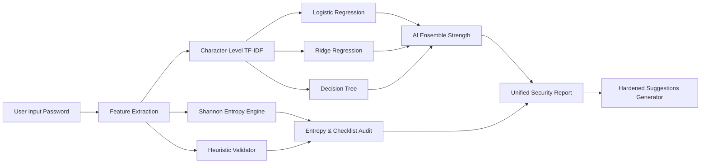

# 🛡️ KAVACH-AI — Intelligent Password Strength & Security Analyzer

<p align="center">
  
</p>

<p align="center">
  <strong>Next-Generation Hybrid AI & Heuristic Password Security Intelligence Engine</strong>
</p>

<p align="center">
  
  
  
  
  
  
  
</p>

---

## 📋 Overview

**KAVACH-AI** (*कवच - The Shield*) is an advanced cyber defense utility engineered to detect, classify, and mitigate weak authentication credentials. Unlike traditional password checkers that rely solely on elementary character checklists, KAVACH-AI couples **Machine Learning models trained on over 600,000 real-world passwords** with **Shannon Entropy calculations** and **rule-based heuristics**.

It accurately identifies subtle structural vulnerabilities, predictable keyboard patterns, and dictionary variations, providing instantaneous feedback and cryptographically fortified password alternatives.

---

## ✨ Key Features

- 🧠 **Multi-Model Machine Learning Ensemble**:
  - **Logistic Regression**: High-confidence baseline classification.
  - **Ridge Regression**: Continuous regularization evaluation.
  - **Decision Tree Regressor**: Non-linear structural pattern classification.
  - **Character-level TF-IDF Vectorization**: Tokenizes n-gram character transitions without token boundary bias.
- 📊 **Shannon Entropy Metric**: Real-time information entropy evaluation measuring password complexity in raw bits of security.
- 🔍 **Deep Rule-Based Heuristic Audit**: Immediate feedback across 5 critical parameters: length, casing diversity, numerical entropy, and special symbol complexity.
- 🔐 **AI Fortification Generator**: Dynamically crafts resilient, hardened password recommendations based on weaknesses discovered in the input.
- ⚡ **Futuristic Cyberpunk UI / UX**:
  - Built with React 19, Vite, and Tailwind CSS.
  - Interactive particle backdrops via `@tsparticles/react`.
  - Fluid micro-animations powered by `framer-motion`.
- 🔌 **Dual Interfaces**:
  - High-performance **REST API** (`/api/analyze`) for seamless integration into auth pipelines.
  - Standalone **Jinja2 Flask Dashboard** for low-footprint server-rendered environments.
- 🛡️ **Zero Telemetry & Privacy Preservation**: Password inputs are processed strictly in-memory and never permanently recorded or stored.

---

## 🏗️ Architecture & Pipeline



---

## 📁 Repository Structure

```text
KAVACH-AI/
├── Dataset/
│   └── data.csv              # Training dataset (600,000+ labeled passwords)
├── frontend/                 # Modern React 19 + Vite web interface
│   ├── public/               # Favicons and SVG vector assets
│   ├── src/
│   │   ├── assets/           # UI graphics and hero visuals
│   │   ├── components/       # Reusable components (Navbar, Footer, Particles)
│   │   ├── pages/            # LandingPage, AnalyzerPage, AboutPage
│   │   ├── App.jsx           # App router and layout wrapper
│   │   ├── index.css         # Custom neon styling & design tokens
│   │   └── main.jsx          # Entry point
│   ├── package.json          # Node dependencies and scripts
│   ├── tailwind.config.js    # Tailwind theme configuration
│   └── vite.config.js        # Vite build tool configuration
├── models/                   # Serialized ML model binaries
│   ├── log_model.pkl         # Logistic Regression artifact
│   ├── ridge_model.pkl       # Ridge Regression artifact
│   ├── tree_model.pkl        # Decision Tree artifact
│   └── vectorizer.pkl        # Fitted TF-IDF character vectorizer
├── templates/
│   └── index.html            # Native Flask web interface template
├── app.py                    # Flask application server & REST API
├── train_models.py           # Model training pipeline
├── requirements.txt          # Python runtime dependencies
├── .gitignore                # Git ignore configuration
└── README.md                 # Project documentation
```

---

## 🚀 Quick Start Guide

### 1. Prerequisites

Ensure you have the following installed:
- [Python 3.9+](https://www.python.org/downloads/)
- [Node.js 18+](https://nodejs.org/) (for the React frontend)
- [Git](https://git-scm.com/)

---

### 2. Clone the Repository

```bash
git clone https://github.com/arjun03125-art/KAVACH-AI.git
cd KAVACH-AI
```

---

### 3. Backend & API Setup (Python / Flask)

1. **Create and activate a virtual environment:**

   ```bash
   # Windows (PowerShell)
   python -m venv venv
   .\venv\Scripts\Activate.ps1

   # Windows (cmd.exe)
   venv\Scripts\activate.bat

   # macOS / Linux
   python3 -m venv venv
   source venv/bin/activate
   ```

2. **Install dependencies:**

   ```bash
   pip install -r requirements.txt
   ```

3. **(Optional) Re-train the Machine Learning Models:**

   *Note: Pre-trained models are already included in the `models/` directory.*  
   If you wish to train them from scratch using `Dataset/data.csv`:

   ```bash
   python train_models.py
   ```

4. **Launch the Flask Server:**

   ```bash
   python app.py
   ```

   The backend API will start at: `http://127.0.0.1:5000`

---

### 4. Modern Frontend Setup (React + Vite)

In a separate terminal window:

```bash
cd frontend
npm install
npm run dev
```

The frontend application will start at: `http://localhost:5173`

---

## 📡 REST API Reference

### Analyze Password

Evaluates a given password string against all machine learning models, heuristics, and entropy metrics.

- **Endpoint:** `/api/analyze`
- **Method:** `POST`
- **Headers:** `Content-Type: application/json`

#### Request Payload:
```json
{
  "password": "SecurePassword#2026"
}
```

#### Response Example:
```json
{
  "final_strength": "Strong",
  "score": 5,
  "entropy": 82.57,
  "results": {
    "Logistic Regression": "Strong",
    "Ridge Regression": "Strong",
    "Decision Tree": "Strong"
  },
  "reasons": [],
  "suggestions": [
    "SecurePassword#2026!k9",
    "SecurePassword#2026@z4",
    "SecurePassword#2026#w7",
    "SecurePassword#2026$p1"
  ]
}
```

---

## 🔬 Machine Learning Pipeline

1. **Tokenization Strategy**: Custom character-level tokenizer (`word_divide_char`) extracting character frequencies and sub-word structures without vocabulary constraints.
2. **Feature Representation**: `TfidfVectorizer` mapping character sequences into high-dimensional vector space.
3. **Training & Validation**:
   - 80% Training partition / 20% Validation test partition.
   - Ground truth labels categorized into:
     - `0`: Weak
     - `1`: Medium
     - `2`: Strong

---

## 🔒 Security & Privacy Notice

- **No Logging**: Passwords analyzed through the interface are processed exclusively in volatile memory and never persisted into databases or log files.
- **Client Processing Capable**: The frontend architecture is built to support pure client-side inspection when integrated with WebAssembly or on-device inference runners.

---

## 🤝 Contributing

Contributions, issues, and feature requests are welcome!

1. Fork the repository
2. Create your feature branch (`git checkout -b feature/SecurityImprovement`)
3. Commit your changes (`git commit -m 'feat: Add entropy metric benchmark'`)
4. Push to the branch (`git push origin feature/SecurityImprovement`)
5. Open a Pull Request

---

## 📄 License

Distributed under the **MIT License**. See `LICENSE` for more information.

---

<p align="center">
  Developed by <a href="https://github.com/arjun03125-art"><strong>arjun03125-art</strong></a> • Securing Digital Identities with AI
</p>
